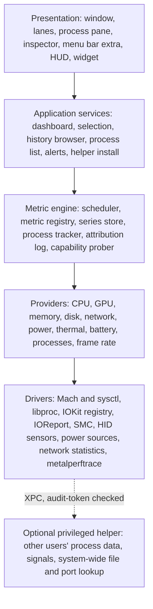

# Coreography product plan

> A graph-first, Mac-native replacement for Activity Monitor. This plan
> builds on the [research](research/README.md); `P1`-`P24` refer to its
> [pattern catalogue](research/README.md#pattern-catalogue). Drafted
> 2026-10-17 from three completed independent proposals (design, power
> user, architecture), merged and checked against the research.

## Contents

- [Vision](#vision)
- [Principles](#principles)
- [Questions it answers](#questions-it-answers)
- [The window](#the-window)
- [Visual language](#visual-language)
- [Satellite surfaces](#satellite-surfaces)
- [Performance mode for games and heavy work](#performance-mode-for-games-and-heavy-work)
- [History, recordings and alerts](#history-recordings-and-alerts)
- [Power tools](#power-tools)
- [MCP and natural-language diagnosis](#mcp-and-natural-language-diagnosis)
- [Architecture](#architecture)
- [Scope](#scope)
- [Roadmap](#roadmap)
- [Risks](#risks)
- [Decisions for the owner](#decisions-for-the-owner)

## Vision

**See what your Mac is doing, who is doing it, and what it did a minute,
an hour or a day ago, in one window.**

Coreography shows every major subsystem at once as live graphs on one
shared time axis. Pointing at a recorded moment names the retained
contributors where attribution is available.
The process list is still there, and stronger than Activity Monitor's, but
it is a pane you summon, not the screen you live in. Every number is
honest about where it came from. The app looks like Apple shipped it and
targets under 1% of one core to run.

## Principles

Each principle comes with a test a reviewer can apply to a screen.

1. **Graphs are the product** (P1). *Test:* at 1440 x 900, charts cover
   more than 60% of the window and every subsystem is visible without a
   tab switch or a second window.
2. **Cause beside symptom** (P2, P3). *Test:* from any recorded spike
   where a source, retention and a matching sample interval exist, one
   gesture reaches the leading recorded contributor; the app does not
   claim a certain cause for an arbitrary spike.
3. **One time axis, one selection** (P4, P8). *Test:* moving the cursor in
   one graph moves it in all of them; selecting anything visibly rescopes
   every view; clearing is explicit.
4. **Measured, never invented** (P18). *Test:* each reading can be forced
   into measured, estimated, restricted and unavailable states, and none
   renders a made-up zero or bridges a gap in sampling.
5. **Colour is a small language.** *Test:* at most seven chart hues, each
   with one documented meaning; all status survives a protanopia and
   deuteranopia simulation.
6. **Quiet by default, forensic on demand** (P16). *Test:* the default
   window has no tabs, no badges, no locked features and at most two
   tinted controls; depth is one deliberate action away.
7. **Observe, do not control.** *Test:* no feature changes fan speeds,
   charging, firewall rules or files. Process actions (quit, signal,
   suspend) are the only mutations, always confirmed where destructive.
8. **The monitor measures itself** (P21). *Test:* Coreography's own CPU,
   memory and wakeups are visible in the app next to the published budget,
   and the budget holds.

## Questions it answers

The window is organised around the questions people bring to Activity
Monitor. Each row is a flow the design must make short.

| Question | Where it is answered | Patterns |
| --- | --- | --- |
| Why is my Mac slow, hot or loud? | Lanes show which subsystem is saturated; hover names the process; thermal lane shows pressure bands and fans | P2, P3, P12 |
| What is eating memory, why am I swapping? | Memory lane: composition, pressure band, swap rate; range select ranks processes by growth | P11, P7 |
| What drained my battery overnight? | Power lane over 12 h with charging bands; logged sleep, wake and assertion history merged with own samples where coverage exists; per-app energy does not reliably account for sleep | P6, P7 |
| Why won't my Mac sleep? | Power inspector: sleep assertions by process, with age | P2 |
| Which app is uploading? | Network lane top contributors; connections tab with endpoints | P2, P9 |
| What is writing to my SSD? | Disk lane, range report by bytes written, cumulative writes per app per day | P7, P15 |
| What happened at 14:02 when it froze? | Scrub or go to 14:02; every lane aligned; table rebuilt from retained contributors, including exited processes where their records survive; not a full reconstruction of every process | P3, P4, P6 |
| Is this game CPU- or GPU-bound, is it throttling? | Performance mode: FPS and frame time, cluster frequency, GPU load, thermal pressure on one axis | P10, P19 |
| What is this process, can I quit it? | Inspector: identity, parent chain, signing, launchd job, plain-language explanation for known system processes | P23 |
| Who holds this file or port? | Reverse lookup in the process pane filter | P23 |
| What starts at login and what does it cost? | Startup tab: items joined to their measured resource use, Apple items hidden by default | P22 |
| Is my machine big enough? | Memory and CPU history over days: pressure time, swap volume, sustained saturation | P6 |
| Which browser tab is eating CPU? | Helpers fold under their browser with role labels (`--type=`); per-tab truth lives in the browser's own task manager, and the app says so instead of guessing a tab map | P20 |
| What is the VM or Docker doing? | VMs and containers appear as ordinary host processes with full host-side cost; the guest interior needs the vendor's API (opt-in, read-only) | P2 |
| Is a local LLM using the GPU? | GPU lane: per-process GPU time and unified-memory footprint (not a separate VRAM pool); opt-in loopback integrations name loaded models; ANE activity shows as power and daemon presence, which cannot identify a model | P10 |

## The window

### Layout decision

Three layouts were proposed: a grid of cards (iStat style), a sparkline
rail with stacked timeline lanes (Task Manager plus Instruments), and the
classic table with bigger graphs. The plan takes **full-width cards
stacked as lanes**: each card keeps iStat's anatomy (label, big value,
secondary facts, top processes) on its left, and its graph fills the rest
of the row. Because every graph has the same horizontal extent, one
vertical cursor crosses all of them, which a grid of differently sized
cards cannot do. That alignment is what makes "what else was happening at
that moment" visible without effort. It is the combined workflow this
survey found least well served by existing Mac monitors.

### Regions

```text
+--------------------------------------------------------------------------------+
| (o)(o)(o)  All Processes v   [1m|10m|1h|6h|24h]   || 1 s v    Search    [i]    |  toolbar
+--------------------------------------------------------------------------------+
|           14:04      14:05      14:06      14:07      14:08      14:09   * Live |  time ruler
+--------------------------------------------------------------------------------+
| CPU          41 %  |                                    /\                     |
| 3.9 GHz  62 C      |  ___/\___/\/\______/\_____________/  \__/\___/\____       |
| Xcode 12  Safari 8 |  E [== 44% 1.5 GHz]   P [===== 38% 3.9 GHz]              |
+--------------------+-----------------------------------------------------------+
| MEMORY   24.1 GB   |  ======================================================== |
| pressure normal    |  app | wired | compressed | cached          [pressure band] |
| Safari 7.5 GB      |                                                           |
+--------------------+-----------------------------------------------------------+
| GPU          12 %  |  __/\____/\_______________________________________/\_     |
+--------------------+-----------------------------------------------------------+
| POWER    8.4 W est |  battery 78 %, 4 h 12 min at this draw                    |
+--------------------+-----------------------------------------------------------+
| DISK   84 MB/s rd  |  reads above the line, writes below                       |
+--------------------+-----------------------------------------------------------+
| NETWORK 6.2 Mb/s   |  download above the line, upload below                    |
+--------------------+-----------------------------------------------------------+
| THERMAL  62 C      |  hottest sensor, pressure bands, fan speed                |
+--------------------------------------------------------------------------------+
| ^ Processes  812 processes, 3,412 threads, top: Xcode 12% CPU    Coreography 0.4% |  detail pane (collapsed)
+--------------------------------------------------------------------------------+
```

- **Toolbar** (Liquid Glass): scope pill (All Processes, or the selected
  app with a clear button), range pills, pause and sampling rate, search,
  inspector toggle.
- **Time ruler**: shared axis labels, the cursor time, a Live chip that
  becomes "Return to now" when you scrub back.
- **Lanes**: one per subsystem, in a fixed, semantic default order
  (compute, cost, pipes, environment). Hide, reorder and resize from each
  lane's menu. Double-click expands a lane into its detail view in place;
  the others compress to thin strips so context stays visible.
- **Detail pane** (bottom, collapsed to a one-line summary by default):
  tabs for Processes, Connections, Startup, Sensors and Recordings. It
  slides up to half or three quarters of the window. The collapsed line
  still answers "is anything running away" and reports coverage (the
  unattributed share and any restricted columns).
- **Inspector** (right, hidden by default): opens when something is
  selected. One inspector, content follows the selection.

There is no sidebar. The lanes are the navigation (P5); a sidebar would
repeat them.

### Lane anatomy

```text
+-- header (260-300 pt) ---+-- graph (rest of the width) ----------------------+
| CPU                 M4 Pro|  peak 92%                                         |
| 41 %                      |      /\        /\                                 |
| user 32  system 9         |  ___/  \______/  \_______/\_____                   |
| 3.9 GHz  62 C             |  [sub-band: E 44% @ 1.5 GHz | P 38% @ 3.9 GHz]     |
| Xcode 12%  Safari 8%  +4  |                                                    |
+---------------------------+----------------------------------------------------+
```

- **Label**: 11 pt, medium weight, small caps, secondary colour. A chip on
  the right names the device (chip, interface, volume).
- **Hero value**: 28-34 pt semibold, tabular digits; unit set smaller in
  secondary colour (iStat's typographic grammar).
- **Secondary facts**: the two numbers a user would otherwise dig for. CPU:
  frequency and temperature. Memory: pressure and swap. Power: battery and
  time at current draw. Network: interface and link.
- **Top contributors**: two or three apps with icon and value, folded into
  apps by default (P20). Clicking one scopes the window to it.
- **Graph**: the lane's chart (grammar below), with optional sub-bands for
  structure (CPU clusters, memory pressure).
- **Sizes**: lanes shed content as they shrink, never the graph. Order of
  shedding: top contributors, secondary facts, sub-bands. Below about 900
  pt of window width the header stacks above the graph.

### Lanes and chart grammar

Global rules: time runs left to right with now at the right edge;
percentages keep a fixed 0-100 scale; rates autoscale to a labelled "nice"
ceiling with the peak printed inside the plot; at most three gridlines;
decimation keeps minima and maxima, never smooths; hover reads raw samples.

| Lane | Question | Hero | Graph | Detail view (expanded) |
| --- | --- | --- | --- | --- |
| CPU | How hard is it working, and who is working it? | Total % of the whole machine, 0-100 | Stacked area, user under system; cluster sub-band with load and frequency per cluster | Per-core heat strip over time grouped by cluster, frequency line, load averages; per-process rows default to 100 * delta(cpuTime) / (delta(elapsed) * logical CPU count), with an option switching them to the one-core-equals-100% convention (`top`-style, values can exceed 100%) |
| Memory | How full and how stressed? | Used of total | Stacked composition (app, wired, compressed, cached) under a capacity line; pressure band on top | Swap in/out rate, compression ratio, page-ins, per-app footprint growth |
| GPU | Is the GPU busy? | Busy % | Area plus GPU memory line; per-app GPU time (ms/s) is a different scale than device utilisation and is labelled as such | Per-app GPU time, frequency, FPS of the frontmost game |
| Power | What does this cost? | System watts from one qualified source: measured system draw, or battery draw, or an estimated SoC draw, whichever is known-valid | Component watts (CPU, GPU, Neural Engine, DRAM) from the fallback ladder's labelled estimate rungs, never summing overlapping rails or double-counting, and not forced to equal the system figure; battery line with charging bands on laptops | Per-app modeled energy, assertions, battery health as nested capacity bars |
| Disk | Is storage the bottleneck? | Read + write rate | Mirrored: reads above, writes below (P9) | Per-volume small multiples, capacity, cumulative writes, SMART health |
| Network | Where is bandwidth going? | Down + up rate | Mirrored: download above, upload below | Per-interface small multiples, per-app traffic, connections |
| Thermal | Is it throttling? | Hottest sensor, with its identity labelled or a pinned sensor so identity changes do not fake a trend | Hottest-sensor line on thermal pressure bands (P12); fan speed | Sensors grouped by region with Current, Min, Max, Average (P15) |

Battery is part of Power, not its own lane. On a desktop Mac the battery
elements are absent, not greyed out.

Reading caveats the UI states rather than hides: cluster frequency and
residency give context about where work likely ran and at what clock,
not proof of where a given process ran or of compute capacity; a QoS
label biases scheduling toward a cluster without proving actual core
placement. Thermal pressure plus a hottest-sensor reading is not proof
of throttling. Per-process GPU time in ms/s is not automatically
utilisation percent, and per-app memory and GPU figures are not
necessarily additive across processes. Per-app energy is each process's
own `ri_energy_nj` modeled estimate, never a sum of `ri_billed_energy`
(which is energy billed to a task by others) and not measured battery
watts; kernel and permission gaps are expected and shown.

### Time

- **Cursor**: hovering any lane draws one hairline through all lanes and
  shows a readout chip: time, value, and "top then" (the leading recorded
  contributors at that instant where a source, retention and a matching
  sample exist, P3). This is the signature interaction.
- **Ranges**: 1 min, 10 min, 1 h, 6 h, 24 h pills, plus scroll and pinch
  to pan and zoom further back, as far as history goes.
- **Range selection** (P7): drag across any lane to select a time window.
  The process pane re-ranks by usage inside the window and the inspector
  shows a range report (top apps per subsystem, totals, percentiles).
  Command-drag a second range to compare two windows.
- **Live edge**: scrubbing or selecting detaches from live; recording
  continues. Space freezes the display while recording continues
  underneath, for screenshotting a fault; a separate Pause Recording
  control stops sampling and leaves a labelled gap. Command-0 returns to
  now.
- **Markers**: automatic markers for sleep and wake, power source changes,
  thermal and memory pressure transitions, observed process starts and
  exits, and the user's own process actions; M drops a named marker.
  Lifecycle markers record first and last observed samples, so processes
  shorter than the sampling interval can be missed, and exit or crash
  reasons appear only where the source provides them. A process is marked
  Not Responding only after the state persists across samples, never on
  one spike.

### Selection and scope

One selection model drives everything (P8). A selection is a time cursor,
an optional time range and at most one entity (an app, a process, a
volume, an interface, a sensor).

Selecting an app or process:

1. The toolbar scope pill shows it, with a clear button.
2. Every lane whose quantity is attributable overlays the app's share as
   a second series in the lane's hue, and its top-contributor list keeps
   the app's rank visible. Thermal, fan, frequency and battery readings
   stay whole-system context; memory and GPU shares are labelled where
   they are not strictly additive.
3. The process pane filters to the app and its helpers.
4. The inspector fills with the app's detail.

Selection is cleared only by Esc or the clear button.

### The process pane

The Processes tab keeps detailed process tools out of the way until
wanted.

- **Grouping**: by app (default, helpers folded under their responsible
  app), as a parent-child tree, flat, or by user.
- **Columns**: a narrow default set (name, CPU %, memory, energy, disk,
  network, GPU ms/s, PID, user) and a catalogue of opt-in columns (threads,
  wakeups, CPU time, QoS split, instructions, ports, architecture,
  signing, start time). Columns that need the helper show "restricted"
  for other users' processes instead of zeros.
- **Heat-shaded cells** (P13) tinted with the subsystem hue, and **change
  highlighting** (P14): new rows tint briefly, exiting rows fade to grey
  "ghost" rows that stay for 30 seconds with their exit status, because
  the culprit has often already quit.
- **Filter grammar** (P22): free text, predicates (`cpu:>10`,
  `mem:>1GB`, `user:root`, `port:8080`, `file:~/Downloads`), tokens
  (`#apps`, `#mine`, `#root`, `#third-party`, `#listening`,
  `#not-responding`, `#preventing-sleep`, `#new`, `#exited`), and saved
  filters as chips.
- **Reverse lookup** (P23): a path, file name or port in the filter
  answers "which process holds this".
- **Actions**: Quit, Force Quit, Suspend and Resume, Send Signal, Renice,
  Sample, Spindump, Reveal in Finder, Copy (as text or JSON). Every
  destructive action re-checks the process identity (PID plus start time)
  before acting, confirms with the consequences stated (child processes,
  open windows, "this logs you out" for session-critical processes), and
  drops a marker on the timeline so the effect is visible on the graphs.

The other tabs:

- **Connections**: per-app connections and listening sockets, with state,
  endpoint and traffic, grouped app, then domain, then server.
- **Startup**: login items, launch agents and daemons, and background
  items, each joined to its measured resource use; Apple-signed items
  hidden by default. Read-only and partial where the sources are;
  Coreography opens the generic System Settings pane to change items
  unless a verified deep link exists.
- **Sensors**: every temperature, fan, voltage and power reading in a
  Current, Min, Max, Average table with a reset (P15), grouped by region,
  each with its source and availability.
- **Recordings**: named capture sessions (see
  [History, recordings and alerts](#history-recordings-and-alerts)).

### The inspector

Content follows the selection:

- **Process or app**: identity (icon, name, PID, user, path, arguments,
  parent chain up to `launchd`, launchd label and plist, code signature
  and team), an explanation for known system processes (what it is, why
  it runs, whether quitting is safe), its own history lanes, resources
  (CPU time, footprint and lifetime peak, energy, wakeups, GPU time, disk
  bytes), open files and ports, sleep assertions, and the actions.
- **Time range**: the range report: per-app totals and shares for each
  subsystem, percentiles, markers inside the range, and Compare, Export
  and Annotate buttons.
- **Lane or device**: static facts (chip, cluster layout, interface,
  volume, SMART status) and the data sources behind each reading.
- **Nothing selected**: system summary (model, chip, OS build, uptime,
  load averages) and Coreography's own cost.

## Visual language

### Liquid Glass

- **Glass**: toolbar, inspector, detail pane chrome, menus, popovers, the
  HUD panel and the menu bar window.
- **No glass**: lanes, graphs, tables. They are content, and Apple's
  guidance keeps glass out of the content layer. Lanes sit on opaque
  grouped-background surfaces with a hairline border; no shadows on
  content.
- **Test matrix**: macOS 27's glass slider at both extremes, light and
  dark, Reduce Transparency, Increase Contrast. Lanes must look identical
  at both slider extremes.

### Colour

All chart colours are system colours, so light, dark and high-contrast
variants come from the platform.

| Hue | Meaning everywhere |
| --- | --- |
| Blue | User work, inbound and download, reads, app memory |
| Orange | System work, outbound and upload, writes |
| Purple | GPU |
| Green | Power and battery charge |
| Indigo and teal | Memory composition partners (wired, compressed) |
| Red | Bad states only: critical pressure, throttling, not responding, disk nearly full |
| Greys | Free, idle, unmeasured |

Paired flows always use blue above and orange below a shared baseline, a
pair that stays distinct for the common colour-vision deficiencies;
Activity Monitor's red and green user/system coding is dropped. Where two
series need more than colour, position or a dashed stroke carries the
second cue. Series are labelled directly at the line ends where space
allows.

### Typography and numbers

- SF Pro throughout; SF Mono only for machine strings (paths, arguments,
  hashes) in the inspector.
- Every live number uses tabular digits so nothing jitters.
- All numbers follow the user's locale (the owner's screenshots use
  `7'167`); units follow macOS conventions (decimal GB as in Finder and
  Disk Utility; bits or bytes stated explicitly for network rates).
- Honest precision: no decimals above 10, one below; "<1%" rather than a
  fake 0.3%.

### States

| State | Rendering |
| --- | --- |
| Measured | Plain |
| Estimated | "est." after the value; hover names the method and its known error |
| Restricted (helper-installable) | Lock glyph, "Needs helper", an Install button; the graph frame stays, empty |
| Restricted (OS-gated or unsupported) | Lock glyph with the reason named; no Install button where only a private entitlement or the OS would lift it |
| Unavailable | Dashed frame, "Not available on this Mac" and the reason; layout does not jump |
| Gap | A visible break in the line; hover gives the missing interval |
| Zero | A flat line at zero with "no activity": a measured zero, distinct from a gap |
| Collecting | "Collecting..." until the first two samples allow a rate |
| Display held | Grey ruler, "Paused" chip; navigation still works; recording continues underneath |
| Recording paused | Sampling stopped; a labelled gap in every series until resumed |

### Motion

Graphs advance at the sampling rate (1 s by default), not the display
refresh rate, and redraw only when data changes. Standard system
animations for panes, nothing springy, numbers change with the system's
numeric transition. With Reduce Motion, scrolling becomes discrete and
highlights become instant. Motion never carries meaning on its own.

### Accessibility and localisation

- Every chart has an `AXChartDescriptor`, which gives VoiceOver users a
  summary and an audio graph; ticking values are announced at a
  throttled rate.
- Every action is reachable from the keyboard, and a command palette
  covers the long tail.
- Localisable from the start: no concatenated strings, locale-aware
  formatting everywhere, right-to-left layouts mirrored except the time
  axis.

### Designed, not vibecoded

Do: system type and colours, standard toolbar, inspector and table
chrome, an 8 pt spacing grid, one documented palette, declared scales and
units on every chart, keyboard navigation, accessibility, gaps and
reasons where data is missing.

Do not: neon, glow, bloom, phosphor or segmented meters; custom display
fonts or a wordmark in the window; a different saturated colour per
subsystem; red against green; rings except for "how full is it" values,
and never more than two on screen; unlabelled autoscaling; smoothed
spikes; animation outliving its sample; feature teasers or locked items
in navigation.

## Satellite surfaces

All satellites render smaller versions of the same lanes from the same
engine (KDE's compact and full "faces" idea). Nothing is reimplemented.

- **Menu bar extra**: up to three items, each a value, a sparkline or
  both. Its window is a column of mini lanes, the top offender, pause, and
  Open Coreography. It does not compete with iStat Menus; it points into
  the window.
- **HUD**: an always-on-top, non-activating floating panel for games and
  heavy work (see next section).
- **Desktop widget**: one compact lane (CPU by default); honest about
  WidgetKit's refresh limits.
- **Dock icon**: optional live CPU or memory graph, as Activity Monitor
  offers.
- **Control Center control**: pause and resume recording, and HUD on and
  off.

## Performance mode for games and heavy work

Apple's Game Overlay (macOS 26) shows no performance numbers. On macOS 27
the system records frame timing for all Metal layers, and
`metalperftrace listen --pid <pid>` streams it live per process at 1-second
intervals, which lets Coreography show a game's frame rate without
touching the game. Each update is an interval summary: it supports a
labelled aggregate FPS, not raw frame pacing, 1% lows or frame-time
percentiles. Single-purpose HUDs already exist on this stream
(zzoko/PerformanceHUD) and on Apple's own HUD (MetalHUDEnabler); the open
gap is a HUD integrated with the monitoring window's history and
attribution, not the HUD itself.

### The HUD

A floating panel with one density control, previewed live (Steam Deck's
slider, P16):

```text
Level 1  [ 118 fps ]

Level 2  [ 118 fps (1 s avg) | CPU 41% | GPU 87% | 18.2 W est | 62 C ]

Level 3  +--------------------------+     Level 4: Level 3 plus per-cluster
         | 118 fps (Metal, 1 s agg) |     load and frequency, memory
         | CPU 41%  P 3.9 GHz       |     pressure and swap, network,
         | GPU 87%  1.4 GHz         |     battery hours at this draw,
         | 18.2 W   62 C   nominal  |     thermal pressure, fans
         +--------------------------+
```

- Corner presets plus drag, opacity, text size, an optional scrim behind
  text for bright scenes, click-through, and remembered position per
  display.
- Two shortcuts: toggle the HUD, cycle its density.
- The FPS source is always named ("Metal, 1 s") and labelled as a
  1-second aggregate; presented, rendered and generated frames are
  distinguished where the source exposes them. The value is absent, not
  zero, when no Metal app is in front.
- A button switches on Apple's own Metal Performance HUD inside the
  running game (`metalperftrace setup --enable hud --pid <pid>`) for
  frame-by-frame detail that a 1-second stream cannot give.
- Making the panel non-activating without changing the whole app's
  activation policy is unsolved and belongs to spike S6. Fullscreen
  support is conditional (native fullscreen,
  compatibility layers such as CrossOver, and Spaces each behave
  differently): a test matrix in spike S6 decides which configurations
  the HUD supports rather than promising blanket coverage.

### Bottleneck hints

The performance view puts FPS and frame time on the same axis as cluster
frequency, GPU load, power and thermal pressure. Labelled hints follow
the PresentMon and RTSS idea: "looks GPU-bound" when GPU load is pinned
while performance cores idle, "looks CPU-bound" when the performance
cluster is saturated at maximum frequency with GPU headroom, "possibly
throttling" when thermal pressure rises and frequency steps down. Each
hint shows its evidence on hover; they are heuristics from thresholds,
not proven verdicts.

### Sessions and comparisons

Command-R records a named session (P19) at full resolution, including
per-process detail. On stop, a report shows average FPS and per-metric
minimum, maximum and average, plus 1% and 0.1% lows and frame-time
percentiles only where raw frame intervals were captured through a
bounded `metalperftrace collect` + `overview` recording, gated on spike
S4 validating that data, and never derived from the 1-second `listen`
summaries. Two sessions compare side by side with overlaid graphs,
CapFrameX style. Sessions export to CSV and JSON.

## History, recordings and alerts

### History

Recording runs whenever the app runs (and, opt-in, in the background
through the menu bar extra). Defaults:

| Tier | Resolution | Kept | Contents |
| --- | --- | --- | --- |
| Live | 1 s | 1 h in memory | All series, top contributors per subsystem |
| Recent | 1 s | 6 h on disk | All series, top 10 contributors per subsystem |
| Day | 10 s | 7 days | System and per-cluster series (not per core), top contributors |
| Month | 1 min | 30 days | System series, per-app daily totals for energy, disk writes and network |

- Downsampled tiers keep minimum, maximum and mean, so spikes survive
  for display. Percentiles over a rolled-up range are computed only from
  raw samples or a validated mergeable distribution, never from
  min/max/mean rollups.
- Attribution history is a bounded per-app cumulative-delta ledger
  covering every observed process the app's permissions allow, not just
  the top N: counter deltas per app plus count, duration, resolution
  and explicit missing intervals. Full-app
  totals count only observed processes over observed counter intervals,
  and missing or restricted processes are labelled rather than silently
  dropped. Coverage is recorded as interval, sample count and duration
  plus explicit unavailable states, not one scalar share: per-app memory
  and GPU figures are not additive across processes, and modeled per-app
  energy is not comparable to measured system watts. A top-N snapshot
  cannot rebuild the full table, totals or percentiles, so the ledger
  does the accounting and top-N snapshots are kept only for instant
  reconstruction. Historical tables show only retained contributors;
  pinned processes and recorded sessions keep full per-process detail for
  bounded windows.
- Sleep and wake history is imported after wake by a bounded provider
  running fixed-argument `pmset -g log`, `pmset -g assertions` and `log
  show` calls, merged with live assertion reads while awake. Sampling
  stops during sleep rather than through it. Show battery change over
  sleep separately from observed awake app activity; assertions do not
  apportion battery drain. Logged wake reasons are evidence, not proven
  culprits. Retention and detail depend on available logs and permissions.
  Sampled
  process starts and ends are never extrapolated across a sleep gap or a
  reboot.
- Retention presets with their disk cost shown, a hard storage cap and a
  hard time cap, and one-click deletion. History stays on this Mac, in a
  per-user 0700 directory with 0600 files holding the minimum identifiers
  needed, and is excluded from backups by default. Backup exclusion is
  not protection: local snapshots and an admin can still read the store,
  and the UI does not claim otherwise. Exports redact identifiers for
  sharing.

### Recordings

A recording is a frozen copy of a time range, every tier plus
attribution, saved as a portable `.coreotrace` package. It opens in
Coreography for scrubbing, replay and comparison, and exports to CSV and
JSON with a documented schema.

### Alerts

A rule is a metric, a threshold, a duration and an action, with
hysteresis ("CPU above 90% for 10 s, clear below 70% for 30 s").

- Most rules should tint the lane rather than notify (silent alerts).
- Notifications respect Focus, have a cooldown, and collapse repeats.
- Shipped rules are few: critical memory pressure for 30 s, serious
  thermal pressure for 30 s, startup disk under 10% free, battery under
  15% while discharging.
- Actions: tint, notification, marker, run a Shortcut.

## Power tools

- **Inspector depth**: arguments, parent chain, launchd job, signing,
  open files and ports, assertions, threads, wakeups, QoS split.
- **Sample, spindump and system diagnostics** use allowlisted system
  tools and validated arguments. Reports open in-app and are exportable;
  protected targets can remain inaccessible.
- **Signals, suspend and resume, renice**, with identity re-check.
- **Reverse lookup** of files and ports, system-wide with the helper.
- **Startup inventory** joined to resource use.
- **Explanations** for system processes: a curated, offline catalogue
  matched on code signature, path and, where the entry needs it, version,
  plus facts read from the
  process itself (launchd plist and scheduling keys, bundle description).
  An entry describes the process's role; it does not claim its current
  job, a completion ETA, or a guarantee that quitting is safe right now.
  Known maintenance work (Spotlight indexing, photo analysis, Time
  Machine, iCloud sync, software updates) is named as a state with "this
  will finish on its own" guidance only where a real status source
  exists: `tmutil status` reports progress, `mdutil -s` reports only
  whether indexing is enabled. Restricted cells distinguish
  helper-installable limits from OS-gated or unsupported ones.
- **Command-line tool** (`coreo`), opt-in: list, top, stats over a time
  range, holders of a file or port, record, export, and `coreo doctor`
  for a data-source report.
- **Automation**: a `coreography://` URL scheme and App Intents
  (current metrics, top processes, start and stop a recording, find the
  holder of a file or port) for Shortcuts and Spotlight.
- **Command palette** (Command-Shift-P) for every action by name.

## MCP and natural-language diagnosis

Two clients of the same diagnostic tools:

- **MCP server**: let an external assistant query live readings and
  recorded history. Coreography needs no model key for this; the client
  chooses its model and credentials.
- **Ask Coreography**: an optional, native question field in the existing
  inspector. Connect a BYO API key to ask questions inside the app. An
  on-device model can be offered where available; model availability and
  tool-calling quality must be proven in spike S9.

The graphs remain the main interface. Asking a question opens an answer
beside the relevant graphs, with links to the processes and time ranges
used as evidence. Example questions:

- "Why is my Mac slow right now?"
- "What's using all my memory?"
- "What changed in the last ten minutes?"
- "What was running when it froze at 14:02?"

### Shared diagnostic contract

One application service supplies the window, CLI, MCP server and in-app
assistant. Start with six bounded, typed tools, reusing existing engine
queries rather than adding another collector:

| Tool | Returns |
| --- | --- |
| `get_system_summary` | CPU activity, memory pressure, swap activity, I/O, available power and thermal context |
| `get_top_processes` | Paged contributors for a named metric and time range, with grouping and coverage |
| `get_metric_history` | A bounded series at its retained resolution, with gaps |
| `get_process_details` | Process identity, resource readings and a matching curated explanation |
| `get_sleep_history` | Available sleep, wake and assertion records for a range |
| `get_data_sources` | Capabilities, source provenance and unavailable or restricted readings |

Results carry units, source intervals, sample age, availability, coverage
and stable evidence references. A question anchors its queries to one
time range and a diagnostic snapshot; each reading still reports its
actual sampling interval. Follow-up calls cannot silently mix a past
selection with live values. Process references include PID and start
time. Server-side limits bound ranges, row counts, output size and query
work, even if a client requests more. Paged results explicitly report
remaining data and return a continuation cursor bound to the query,
snapshot and approved scope. Invalid or expired cursors fail explicitly.
Requests exceeding range or work budgets return an actionable error;
partial results are labelled with their coverage, never silently treated
as complete.

The diagnostic service computes facts and structured signals, such as
sustained memory pressure with swap activity. The model explains them
and proposes hypotheses. Render numeric evidence directly from tool
results, with clickable source references; distinguish observations from
possible causes and say when data is insufficient. Neither a busy
process nor simultaneous spikes alone proves why the Mac feels slow.

### MCP access

Start with opt-in local stdio through `coreo mcp --stdio`, connected to
the running app's diagnostic service over peer-authenticated local IPC.
Validate the actual peer's user and process identity. A CLI bridge is not
proof of which external assistant launched it: each client pairing needs
one-time approval in the app and a scoped, revocable app-issued grant.
Client-provided names are display metadata, never authentication, and
cannot reuse another client's approval.

Multiple clients share the sampler and store, with per-session and
global query-rate, concurrency and work budgets. Settings shows approved
clients, their scopes and connected sessions, with individual revocation.
Check grants at request dispatch and result delivery; disabling access
closes sessions, cancels pending queries and rejects further requests.

The first tool set is read-only. It exposes neither arbitrary SQL, shell
commands nor process-control actions, and enabling MCP cannot install
the privileged helper or broaden the approved data-access scope.
App names and activity may leave the Mac through the external assistant;
that client's provider and retention settings govern its subsequent use.

### In-app assistant and credentials

Configure a provider and save its key in macOS Keychain. Keep keys out of
preferences, history, logs, exports and MCP results. Show the selected
provider, the data-sharing scope and the diagnostic context attached to
each question. Provider setup authorizes that scope; individual tool
reads do not need repeated confirmation. Prompts and selected diagnostic
results go directly to the chosen provider, without a Coreography relay.

Default context is resource metrics, basic app identities and curated
descriptions. Arguments, environment variables, full paths, file lists
and network endpoints are excluded from default model context and MCP
responses. Broader disclosure requires an explicit scope change. Treat
every process-supplied name or string as data, never as tool instructions.

Start with one BYO provider adapter; add providers only when demand and
the S9 compatibility tests justify them. Keep model transport, credential
storage and response parsing behind provider/driver interfaces, separate
from the metric engine. Calls run only on explicit questions, with
cancellation, request budgets and visible provider errors. Monitoring
continues if inference is slow, unavailable or cancelled. Without a
model, charts, diagnostics, curated explanations and MCP still work.

### Delivery and acceptance

Ship the diagnostic contract and local MCP access with the power-tool
milestone. Add the optional in-app assistant after that contract passes
S9, with BYO cloud access first if on-device results are insufficient.
It is not a gate for the first graph-first beta.

Use recorded fixtures for the two headline questions: memory pressure
with a known growing app, and a slowdown with competing or insufficient
signals. Require matching evidence references and correct missing-data
handling. Exercise MCP initialization, tool discovery, pagination,
invalid or oversized requests, client disconnect and disable/revocation.
Reject unapproved clients, forged client names and revoked grants,
including revocation during a query. Exercise expired cursors and request
floods against session and global budgets. Check redaction, forged tool
arguments, hostile process strings, key handling, provider failures and
cancellation. Measure query and inference overhead separately from idle
monitoring; neither may block collection or the window.

## Architecture

### Layers

Strict layering: each layer talks only to the one directly below it.
Nothing above the drivers touches IOKit, IOReport, `libproc` or `sysctl`.



The metric engine is a Swift package with no UI dependency. The app and
the `coreo` command-line tool are both clients of it, so diagnostics,
fixtures, benchmarks and tests run the same engine as the window.
The application-layer diagnostic service owns the shared tool contract;
MCP and Ask Coreography use it rather than accessing drivers or storage
directly. The Ask service executes validated model tool calls through
that contract, subject to the same permissions and query limits.

### Metric model

- Every sample carries a metric identity, value, unit, monotonic and wall
  timestamps, an **availability** (measured, estimated with method,
  restricted with reason, unsupported, unavailable) and **provenance**
  (provider, driver, channel, chip profile version).
- Providers emit either cumulative counters or direct gauge samples.
  Rates come only from counter deltas over the real elapsed time between
  samples; counter resets become gaps. Gauges such as temperature, memory
  footprint and frequency are stored as point samples, never differenced.
- Process identity is PID plus start time everywhere: deltas, history,
  attribution and actions.
- "Top contributors" is a value type of its own, stored and replayed like
  any other series.

### Sampling

One scheduler owns all timing; providers register a metric set and a cost
class.

| Class | Examples | Default cadence |
| --- | --- | --- |
| Live | CPU, GPU, disk and network rates, frame rate | 1 s |
| Frequency and power | Cluster frequency and residency, watts | 1 s |
| Processes | Process set, per-process usage, top contributors | 2 s |
| Memory | Composition, swap, pressure (plus pressure events) | 2 s |
| Thermal | Temperatures, fans, thermal pressure | 4 s |
| Inventory | Battery health, capacity, SMART | 60 s plus events |

- Hidden main window: its rendering stops, but sampling for a visible HUD
  or menu bar extra keeps its live cadence. Only when nothing visible
  remains does sampling drop to a 10-second record-only cadence, so
  history stays continuous at low cost.
- Low Power Mode on battery: cadences halve, and the app says so.
- App Nap is respected; missed samples become visible gaps.
- No subprocesses on the hot path (`ps`, `top`, `nettop`), except the
  frame-rate stream from `metalperftrace`, which runs only while
  performance mode is on.

### Chip profiles and fallback ladders

Everything that varies by chip or OS release is data, not code. Bundled
chip profiles name cluster letters, frequency tables, IOReport channels,
SMC keys and sensor names. An unknown chip falls back to a generic profile
probed at runtime. Each metric has a fallback ladder evaluated at launch,
after wake and periodically while degraded. For example, CPU and GPU power
on macOS 27:

```text
1. IOReport energy model counters      estimated  (may freeze without
                                                     Apple's private entitlement)
2. AppleCLPC energy counters           estimated  (as macmon 0.9 reads them)
3. PMP energy histograms               estimated  (where present)
4. SMC power rails                     estimated  (community-tested on few chips)
5. none                                restricted, with the reason shown
```

A Data Sources pane in Settings lists every metric, its active rung,
provenance and last error, and `coreo doctor` exports the same report for
bug reports.

### Privileged helper

- Optional, installed at the moment of need through `SMAppService` from a
  restricted cell's Install button, removable in Settings. The approval
  state (pending, approved, needs re-approval, removed) is always visible.
- A deliberately tiny XPC interface: enrich processes (usage for other
  users' processes), list files and ports of a process, send a signal,
  spindump. The protocol rejects arbitrary commands and executable paths.
  Only its fixed diagnostics may launch system tools; reports return to
  the app rather than being written to caller-selected paths as root.
- Every connection is validated against the app's code signature through
  its audit token before the request is read. iStat Menus' two helper
  vulnerabilities are the checklist of what not to do.
- The helper is not a privilege bypass: it does not lift TCC, SIP or
  Apple's private entitlements, and task-port-gated fields on
  SIP-protected or hardened processes stay restricted even with it.
- Declining costs only the restricted cells; everything else works.

### Storage

The default candidate is the system SQLite (`sqlite3` ships with macOS,
so it is not an added dependency): WAL mode, a per-user 0700 directory
with 0600 files, hard storage and time caps, and crash-safe atomic
retention. A custom append-only segment store is the fallback if a
measured storage spike shows SQLite cannot hold the budget. The choice
is measured, not asserted, and no precise disk costs are claimed ahead of
it. Rolled-up tiers keep minimum, maximum and mean for display; range
percentiles require raw samples or a validated mergeable distribution.
The attribution ledger is a separate per-app cumulative-delta store with
interned process identities and explicit coverage intervals. A numerical
unattributed share is shown only for quantities with compatible additive
system and process accounting.

### Rendering

| Surface | Renderer |
| --- | --- |
| Live lanes, sparklines, menu bar, HUD | A small custom Core Animation view that swaps a path per sample |
| History, zoom, range selection, detail views | Swift Charts with vectorised plots, data decimated to about one point per pixel |
| Per-core heat strips | Swift Charts rectangles or a Core Animation layer grid, decided by spike S2 |

Redraw at the slower of the sampling rate and 30 frames per second, with
the frame-rate range declared to the system. A smooth-scrolling 60 Hz
option is opt-in and labelled with its cost. The custom renderer needs an
explicit accessibility implementation (chart descriptor and VoiceOver
summary), which lands in the first milestone alongside the Swift Charts
surfaces.

### Concurrency

Swift 6 with strict concurrency from the first commit. The engine and
each provider are actors; C handles (IOReport subscriptions, SMC
connection, HID client) live in drivers confined to their own serial
queues. The UI receives one value-type snapshot per tick per cadence
class, so SwiftUI sees one change per tick.

### Self-cost budget

| Budget | Target |
| --- | --- |
| CPU, window open, 1 s sampling | Under 1% of one core on an M1 |
| CPU, window hidden, recording | Under 0.3% |
| Memory footprint | Under 150 MB |
| Wakeups beyond the sampling rate | Under 5 per second |
| Launch to first paint | Under 0.8 s |
| First computed rate | Under 2.5 s (needs two samples at the default 1 s tick) |

Every target above is unmeasured until spike S2 lands numbers. Self-cost
covers the whole product: the app, the helper, any subprocess such as
`metalperftrace` while performance mode runs, and render cost, not just
the engine. The engine benchmark runs in CI with recorded fixtures;
hardware numbers are measured per release and published with it.

### Testing

- Recorded fixtures per chip (IOReport channels, SMC keys, sensors,
  sysctl, process tables) replayed through stub drivers, so providers
  are tested in CI without hardware.
- Golden tests per chip and OS for which fallback rung each metric lands
  on.
- Edge cases: counter resets, frozen counters, absurd temperatures, PID
  reuse, permission errors.
- Snapshot tests for every chart and state at both glass extremes and
  with Increase Contrast.
- Overnight soak tests on hardware for memory growth and store integrity.

### Project, build and distribution

- Packages: drivers, engine (`CoreographyKit`), store, UI; targets: the
  app, the `coreo` tool, the helper.
- macOS 26 or later. Recommendation (decision 1 stays with the owner):
  keep the repo's `--universal` arm64+x86_64 baseline, gate the
  Apple-Silicon-only hardware telemetry (clusters, frequency, watts,
  sensors) at runtime on Intel, and gate macOS 27 features at runtime.
  "Universal" never labels an arm64-only build.
- Developer ID signing, hardened runtime, notarized DMG, Sparkle updates.
  No App Store build: sandbox restrictions on process introspection and
  IOKit user clients conflict with the planned feature set. Some process
  enumeration is permitted; restrictions depend on the API and OS.
- Repository conventions from `AGENTS.md`: `scripts/build.sh`,
  `scripts/release.sh` with annotated tags, the macOS CI leg, a
  tag-triggered release workflow.
- One planned third-party runtime dependency (Sparkle); model adapters
  use system networking. No telemetry or analytics. Network activity is
  the update check and requested downloads, an optional off-by-default
  connectivity probe, opt-in read-only loopback integrations, and explicit
  Ask Coreography requests to the chosen provider with the approved
  context. External MCP clients have their own network policies. Chip
  profiles ship bundled with the app and change only through a signed app
  release; nothing updates them silently.

## Scope

### MVP (first public beta)

1. The window: lanes on a shared time axis, cursor attribution, range
   selection, the collapsed process pane with grouping, heat cells,
   change highlighting, filtering and basic actions, the inspector.
   Keyboard-complete navigation, `AXChartDescriptor` on every chart and a
   table alternative to every graph land in this first milestone, not in
   a later pass.
2. The unprivileged engine, in slices: CPU, memory, disk, network
   interfaces and own-user per-app attribution first; Apple Silicon
   cluster, frequency, power, thermal, sensor and battery providers join
   as their spikes (S1, S2) clear the honesty gates.
3. One hour of in-memory history and six hours on disk.
4. Honest states and the self-cost readout.
5. Keyboard navigation, pause, CSV and JSON export of a range.

Acceptance gates the first slice must pass before widening:

- The per-app ledger includes observed tail apps, not just top
  contributors, and reports coverage intervals and missing data. A
  compatible additive metric also reports its unattributed remainder.
- Every permission path renders its restricted or unavailable state:
  helper declined, the same-uid wall, a missing sensor or a broken
  channel.
- Sleep appears as imported history with the gap marked, and the store
  honours its privacy rules (permissions, redacted exports, real
  deletion).
- Charts stay legible at both ends of the glass-opacity slider, in light
  and dark, with Increase Contrast, and read correctly through VoiceOver.

### 1.0

1. Full history tiers, markers, range reports and comparison.
2. The helper: other users' processes, system-wide lookup, spindump.
3. Connections, Startup and Sensors tabs.
4. Menu bar extra, HUD, performance mode with frame rate on macOS 27,
   recordings with percentiles.
5. Alerts.
6. Process explanations and maintenance states.
7. Command-line tool, URL scheme, App Intents, shared diagnostic tools and
   opt-in local MCP access. Optional Ask Coreography follows the S9 gate.
8. Accessibility pass with audio graphs; localisation infrastructure.

### Later

Per-file disk activity tracing (bounded, helper), desktop widget and
Control Center control, a process-launch event timeline (needs the
Endpoint Security entitlement), Prometheus-style export, Wi-Fi details,
and opt-in read-only loopback integrations for local LLM runtimes
(Ollama, LM Studio) and container engines, where the vendor API reports
the guest or model detail the OS cannot.

### Out of scope

Fan control, charge limiting, firewall rules, file deletion and disk
cleaning, benchmarks, reputation lookups, remote or multi-Mac dashboards,
themes and skins, cross-platform builds.

## Roadmap

### Spikes first

Each spike runs on real hardware (an M1 and the newest available chip,
macOS 27) and ends with a written result in `docs/spikes/`. Until a spike
reports, every hardware-dependent assertion in this plan stays
unverified.

| Spike | Question | Decides |
| --- | --- | --- |
| S1 Power | Which power source is within 10% of `powermetrics` on each chip? | Ladder order and "estimated" labels |
| S2 Rendering | Do seven live lanes at 1 s plus a 500-row table stay under 1% CPU on an M1? | Renderer split |
| S3 Network | Is the private network statistics framework usable without prompts on macOS 27? | Per-app network in MVP or interfaces only |
| S4 Frame rate | What does `listen --json` emit and cost, and do bounded `collect` plus `overview --json-include-timeline` captures expose usable raw intervals? Test permissions, multiple layers, CrossOver and presented versus generated frames | Aggregate HUD and raw-frame report scope |
| S5 Helper | Which columns go blank for root processes without the helper; how does "not responding" get detected? | Default experience without the helper |
| S6 HUD | Can a non-activating panel float over native full-screen Metal games and across Spaces? | HUD feasibility |
| S7 Storage and ledger | Do the SQLite store plus the tail-app attribution ledger hold the write budget under retention caps and crash recovery, and do min/max/mean rollups stay honest (no percentiles from rollups)? | Store choice and ledger design |
| S8 Sleep, logs and permissions | Do `pmset` and `log show` imports cover overnight gaps, and do permission boundaries, backup exclusion and export redaction behave as claimed? | Sleep-history scope and privacy defaults |
| S9 Diagnostic clients | Can MCP and one model client answer the two headline questions from the same bounded tool results, preserve evidence and privacy, and cancel without blocking monitoring? Test BYO and available on-device models | MCP contract and optional assistant scope |

### Milestones

| Milestone | Content | Done when |
| --- | --- | --- |
| M0 Foundations | Xcode project and packages, build script, macOS CI leg, `coreo` skeleton, spikes S1-S8 | Spike reports merged; engine builds and tests headless in CI |
| M1 Engine | Metric model, scheduler, CPU, memory, process, disk and network providers, in-memory store | `coreo` streams honest metrics at 1 s within the tick budget |
| M2 Silicon | IOReport, SMC and HID drivers, chip profiles, power, frequency, thermal and GPU providers, Data Sources report | Full sensor set on the test chips; virtual machine run shows correct "unavailable" states |
| M3 Window | Lanes, cursor, process pane, inspector, states, self-cost, accessibility | The owner uses it instead of Activity Monitor for a week; every chart has an AX descriptor and a keyboard/table alternative; self-cost measured end to end (app, helper, subprocess, render) |
| M4 History | Disk store, scrubbing, attribution in time, range reports, markers, export | 24-hour soak clean; "who was on top at 14:02" works; MVP beta ships |
| M5 Power tools | Helper, other users' processes, files and ports, reverse lookup, sample and spindump, Startup and Connections tabs, filter grammar, diagnostic tools and local MCP | Helper and MCP access tests pass; declining either preserves the unprivileged dashboard; one sampler serves UI and clients |
| M6 Ambient and performance | Menu bar extra, HUD, frame rate, recordings and comparison, alerts, explanations; optional Ask Coreography after S9 | HUD matches the S6 matrix; aggregate and raw-frame statistics stay distinct; reference captures match; any enabled assistant passes S9 evidence, privacy and cancellation tests |
| M7 1.0 | Accessibility, localisation, Settings, Sparkle, notarized release, published performance report | Release checklist complete; 1.0 tagged |

## Risks

| Risk | Mitigation |
| --- | --- |
| Apple gates or renames power and sensor channels again | Chip profiles as data, fallback ladders, runtime probes, visible "restricted" states, `coreo doctor` reports |
| `metalperftrace listen` changes or is unsuitable | It is used only in performance mode, behind a capability check; without it the HUD shows everything but frame rate |
| Private network statistics break | Feature flag; fall back to per-interface totals |
| Swift Charts cannot hold the budget for live lanes | Live lanes already use a custom layer; Charts only for interactive history |
| Helper vulnerability | Minimal protocol, audit-token code-signature checks, no command surface, review against the iStat Menus CVEs |
| Overclaiming attribution | Boundaries stated in the UI: browser tabs need browser cooperation, VM and container interiors need vendor APIs, ANE or daemon presence cannot identify a model or prove inference |
| Self-cost creep | Published budget, CI benchmark gate, in-app self-cost |
| History store reveals activity (app names, endpoints) | Local only, 0700/0600 permissions, minimal identifiers, excluded from backups (which is not admin or snapshot protection and is not sold as such), retention controls, one-click purge, redacted exports |
| Frozen counters read as idle zero | Capability probes distinguish a legitimate zero from a stuck counter; the distinction is tested per chip profile |
| Model explanations invent causes or expose sensitive context | Structured diagnostic evidence, scoped read-only tools, redaction, Keychain credentials and explicit provider selection; missing evidence stays unknown |
| Enabled MCP exposes activity or exhausts resources through unapproved clients | Off by default, peer-authenticated IPC, scoped client grants, individual revocation, session and global budgets, visible sessions and one-switch disable |
| Scope creep into control features | Principle 7; rejected at proposal time |

## Decisions for the owner

These need an answer before or during M0. Each has a recommendation.

1. **Minimum macOS and architectures.** Recommend macOS 26 Tahoe built
   universal (arm64+x86_64) per the repo's `--universal` convention, with
   Apple-Silicon-only telemetry (clusters, frequency, watts, sensors)
   gated at runtime on Intel and macOS 27 features (frame rate) gated on
   OS version. Alternatives: Apple Silicon only, which drops Intel Macs
   still on macOS 26, or macOS 27 only, a smaller audience at launch.
   Whatever is chosen, "universal" is never applied to an arm64-only
   build.
2. **Licence and price.** The repository is public domain (Unlicense), so
   the default is a free, open-source app. Confirm, or decide on a paid
   or donation model before any code lands.
3. **History default.** Recommend recording while the app runs, with
   background recording opt-in through the menu bar extra.
4. **Natural-language access.** Recommend local MCP first, then an
   optional BYO-key assistant using the same tools. Evaluate on-device
   support in S9. Curated process explanations remain the offline
   baseline; the model adds evidence-backed narrative, not new readings.
5. **Helper prompt.** Recommend offering it only at the moment of need,
   never at first launch.
