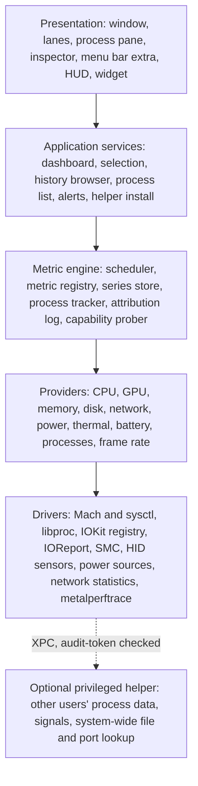

# Coreography product plan

> A graph-first, Mac-native replacement for Activity Monitor. This plan
> builds on the [research](research/README.md); `P1`-`P24` refer to its
> [pattern catalogue](research/README.md#pattern-catalogue). Drafted
> 2026-10-17 from four independent proposals (design, power user,
> architecture, performance enthusiast), merged and checked against the
> research.

## Contents

- [Vision](#vision)
- [Principles](#principles)
- [Questions it answers](#questions-it-answers)
- [The window](#the-window)
- [Visual language](#visual-language)
- [Satellite surfaces](#satellite-surfaces)
- [Performance mode for games and heavy work](#performance-mode-for-games-and-heavy-work)
- [History, recordings and alerts](#history-recordings-and-alerts)
- [Power tools](#power-tools)
- [Architecture](#architecture)
- [Scope](#scope)
- [Roadmap](#roadmap)
- [Risks](#risks)
- [Decisions for the owner](#decisions-for-the-owner)

## Vision

**See what your Mac is doing, who is doing it, and what it did a minute,
an hour or a day ago, in one window.**

Coreography shows every major subsystem at once as live graphs on one
shared time axis. Pointing at any moment names the processes responsible.
The process list is still there, and stronger than Activity Monitor's, but
it is a pane you summon, not the screen you live in. Every number is
honest about where it came from. The app looks like Apple shipped it and
costs less than 1% of one core to run.

## Principles

Each principle comes with a test a reviewer can apply to a screen.

1. **Graphs are the product** (P1). *Test:* at 1440 x 900, charts cover
   more than 60% of the window and every subsystem is visible without a
   tab switch or a second window.
2. **Cause beside symptom** (P2, P3). *Test:* from any visible spike,
   live or past, one gesture reaches the responsible process.
3. **One time axis, one selection** (P4, P8). *Test:* moving the cursor in
   one graph moves it in all of them; selecting anything visibly rescopes
   every view; clearing is explicit.
4. **Measured, never invented** (P18). *Test:* each reading can be forced
   into measured, estimated, restricted and unavailable states, and none
   renders a made-up zero or bridges a gap in sampling.
5. **Colour is a small language.** *Test:* at most seven chart hues, each
   with one documented meaning; all status survives a protanopia and
   deuteranopia simulation.
6. **Quiet by default, forensic on demand** (P16). *Test:* the default
   window has no tabs, no badges, no locked features and at most two
   tinted controls; depth is one deliberate action away.
7. **Observe, do not control.** *Test:* no feature changes fan speeds,
   charging, firewall rules or files. Process actions (quit, signal,
   suspend) are the only mutations, always confirmed where destructive.
8. **The monitor measures itself** (P21). *Test:* Coreography's own CPU,
   memory and wakeups are visible in the app next to the published budget,
   and the budget holds.

## Questions it answers

The window is organised around the questions people bring to Activity
Monitor. Each row is a flow the design must make short.

| Question | Where it is answered | Patterns |
| --- | --- | --- |
| Why is my Mac slow, hot or loud? | Lanes show which subsystem is saturated; hover names the process; thermal lane shows pressure bands and fans | P2, P3, P12 |
| What is eating memory, why am I swapping? | Memory lane: composition, pressure band, swap rate; range select ranks processes by growth | P11, P7 |
| What drained my battery overnight? | Power lane over 12 h with charging bands; range report ranks apps by energy; assertions explain missed sleep | P6, P7 |
| Why won't my Mac sleep? | Power inspector: sleep assertions by process, with age | P2 |
| Which app is uploading? | Network lane top contributors; connections tab with endpoints | P2, P9 |
| What is writing to my SSD? | Disk lane, range report by bytes written, cumulative writes per app per day | P7, P15 |
| What happened at 14:02 when it froze? | Scrub or go to 14:02; every lane aligned; table re-derived for that instant, including processes that have since exited | P3, P4, P6 |
| Is this game CPU- or GPU-bound, is it throttling? | Performance mode: FPS and frame time, cluster frequency, GPU load, thermal pressure on one axis | P10, P19 |
| What is this process, can I quit it? | Inspector: identity, parent chain, signing, launchd job, plain-language explanation for known system processes | P23 |
| Who holds this file or port? | Reverse lookup in the process pane filter | P23 |
| What starts at login and what does it cost? | Startup tab: items joined to their measured resource use, Apple items hidden by default | P22 |
| Is my machine big enough? | Memory and CPU history over days: pressure time, swap volume, sustained saturation | P6 |

## The window

### Layout decision

Three layouts were proposed: a grid of cards (iStat style), a sparkline
rail with stacked timeline lanes (Task Manager plus Instruments), and the
classic table with bigger graphs. The plan takes **full-width cards
stacked as lanes**: each card keeps iStat's anatomy (label, big value,
secondary facts, top processes) on its left, and its graph fills the rest
of the row. Because every graph has the same horizontal extent, one
vertical cursor crosses all of them, which a grid of differently sized
cards cannot do. That alignment is what makes "what else was happening at
that moment" visible without effort, and it is the main thing no
competitor offers.

### Regions

```text
+--------------------------------------------------------------------------------+
| (o)(o)(o)  All Processes v   [1m|10m|1h|6h|24h]   || 1 s v    Search    [i]    |  toolbar
+--------------------------------------------------------------------------------+
|           14:04      14:05      14:06      14:07      14:08      14:09   * Live |  time ruler
+--------------------------------------------------------------------------------+
| CPU          41 %  |                                    /\                     |
| 3.9 GHz  62 C      |  ___/\___/\/\______/\_____________/  \__/\___/\____       |
| Xcode 12  Safari 8 |  E [== 44% 1.5 GHz]   P [===== 38% 3.9 GHz]              |
+--------------------+-----------------------------------------------------------+
| MEMORY   24.1 GB   |  ======================================================== |
| pressure normal    |  app | wired | compressed | cached          [pressure band] |
| Safari 7.5 GB      |                                                           |
+--------------------+-----------------------------------------------------------+
| GPU          12 %  |  __/\____/\_______________________________________/\_     |
+--------------------+-----------------------------------------------------------+
| POWER    8.4 W est |  battery 78 %, 4 h 12 min at this draw                    |
+--------------------+-----------------------------------------------------------+
| DISK   84 MB/s rd  |  reads above the line, writes below                       |
+--------------------+-----------------------------------------------------------+
| NETWORK 6.2 Mb/s   |  download above the line, upload below                    |
+--------------------+-----------------------------------------------------------+
| THERMAL  62 C      |  hottest sensor, pressure bands, fan speed                |
+--------------------------------------------------------------------------------+
| ^ Processes  812 processes, 3,412 threads, top: Xcode 12% CPU    Coreography 0.4% |  detail pane (collapsed)
+--------------------------------------------------------------------------------+
```

- **Toolbar** (Liquid Glass): scope pill (All Processes, or the selected
  app with a clear button), range pills, pause and sampling rate, search,
  inspector toggle.
- **Time ruler**: shared axis labels, the cursor time, a Live chip that
  becomes "Return to now" when you scrub back.
- **Lanes**: one per subsystem, in a fixed, semantic default order
  (compute, cost, pipes, environment). Hide, reorder and resize from each
  lane's menu. Double-click expands a lane into its detail view in place;
  the others compress to thin strips so context stays visible.
- **Detail pane** (bottom, collapsed to a one-line summary by default):
  tabs for Processes, Connections, Startup, Sensors and Recordings. It
  slides up to half or three quarters of the window. The collapsed line
  still answers "is anything running away".
- **Inspector** (right, hidden by default): opens when something is
  selected. One inspector, content follows the selection.

There is no sidebar. The lanes are the navigation (P5); a sidebar would
repeat them.

### Lane anatomy

```text
+-- header (260-300 pt) ---+-- graph (rest of the width) ----------------------+
| CPU                 M4 Pro|  peak 92%                                         |
| 41 %                      |      /\        /\                                 |
| user 32  system 9         |  ___/  \______/  \_______/\_____                   |
| 3.9 GHz  62 C             |  [sub-band: E 44% @ 1.5 GHz | P 38% @ 3.9 GHz]     |
| Xcode 12%  Safari 8%  +4  |                                                    |
+---------------------------+----------------------------------------------------+
```

- **Label**: 11 pt, medium weight, small caps, secondary colour. A chip on
  the right names the device (chip, interface, volume).
- **Hero value**: 28-34 pt semibold, tabular digits; unit set smaller in
  secondary colour (iStat's typographic grammar).
- **Secondary facts**: the two numbers a user would otherwise dig for. CPU:
  frequency and temperature. Memory: pressure and swap. Power: battery and
  time at current draw. Network: interface and link.
- **Top contributors**: two or three apps with icon and value, folded into
  apps by default (P20). Clicking one scopes the window to it.
- **Graph**: the lane's chart (grammar below), with optional sub-bands for
  structure (CPU clusters, memory pressure).
- **Sizes**: lanes shed content as they shrink, never the graph. Order of
  shedding: top contributors, secondary facts, sub-bands. Below about 900
  pt of window width the header stacks above the graph.

### Lanes and chart grammar

Global rules: time runs left to right with now at the right edge;
percentages keep a fixed 0-100 scale; rates autoscale to a labelled "nice"
ceiling with the peak printed inside the plot; at most three gridlines;
decimation keeps minima and maxima, never smooths; hover reads raw samples.

| Lane | Question | Hero | Graph | Detail view (expanded) |
| --- | --- | --- | --- | --- |
| CPU | How hard is it working, and who is working it? | Total % | Stacked area, user under system; cluster sub-band with load and frequency per cluster | Per-core heat strip over time grouped by cluster, frequency line, load averages |
| Memory | How full and how stressed? | Used of total | Stacked composition (app, wired, compressed, cached) under a capacity line; pressure band on top | Swap in/out rate, compression ratio, page-ins, per-app footprint growth |
| GPU | Is the GPU busy? | Utilisation % | Area plus GPU memory line | Per-app GPU time, frequency, FPS of the frontmost game |
| Power | What does this cost? | System watts | Stacked watts by component (CPU, GPU, Neural Engine, DRAM); battery line with charging bands on laptops | Per-app energy, assertions, battery health as nested capacity bars |
| Disk | Is storage the bottleneck? | Read + write rate | Mirrored: reads above, writes below (P9) | Per-volume small multiples, capacity, cumulative writes, SMART health |
| Network | Where is bandwidth going? | Down + up rate | Mirrored: download above, upload below | Per-interface small multiples, per-app traffic, connections |
| Thermal | Is it throttling? | Hottest sensor | Hottest-sensor line on thermal pressure bands (P12); fan speed | Sensors grouped by region with Current, Min, Max, Average (P15) |

Battery is part of Power, not its own lane. On a desktop Mac the battery
elements are absent, not greyed out.

### Time

- **Cursor**: hovering any lane draws one hairline through all lanes and
  shows a readout chip: time, value, and "top then" (the top processes at
  that instant, P3). This is the signature interaction.
- **Ranges**: 1 min, 10 min, 1 h, 6 h, 24 h pills, plus scroll and pinch
  to pan and zoom further back, as far as history goes.
- **Range selection** (P7): drag across any lane to select a time window.
  The process pane re-ranks by usage inside the window and the inspector
  shows a range report (top apps per subsystem, totals, percentiles).
  Command-drag a second range to compare two windows.
- **Live edge**: scrubbing or selecting detaches from live; recording
  continues. Space pauses sampling for a screenshot of a fault; Command-0
  returns to now.
- **Markers**: automatic markers for sleep and wake, power source changes,
  thermal and memory pressure transitions, app launches and crashes, and
  the user's own process actions; M drops a named marker.

### Selection and scope

One selection model drives everything (P8). A selection is a time cursor,
an optional time range and at most one entity (an app, a process, a
volume, an interface, a sensor).

Selecting an app or process:

1. The toolbar scope pill shows it, with a clear button.
2. Every lane overlays the app's share of the total as a second series in
   the lane's hue, and its top-contributor list keeps the app's rank
   visible.
3. The process pane filters to the app and its helpers.
4. The inspector fills with the app's detail.

Selection is cleared only by Esc or the clear button.

### The process pane

The Processes tab in the detail pane is the strongest process table on
the platform, kept out of the way until wanted.

- **Grouping**: by app (default, helpers folded under their responsible
  app), as a parent-child tree, flat, or by user.
- **Columns**: a narrow default set (name, CPU %, memory, energy, disk,
  network, GPU %, PID, user) and a catalogue of opt-in columns (threads,
  wakeups, CPU time, QoS split, instructions, ports, architecture,
  signing, start time). Columns that need the helper show "restricted"
  for other users' processes instead of zeros.
- **Heat-shaded cells** (P13) tinted with the subsystem hue, and **change
  highlighting** (P14): new rows tint briefly, exiting rows fade to grey
  "ghost" rows that stay for 30 seconds with their exit status, because
  the culprit has often already quit.
- **Filter grammar** (P22): free text, predicates (`cpu:>10`,
  `mem:>1GB`, `user:root`, `port:8080`, `file:~/Downloads`), tokens
  (`#apps`, `#mine`, `#root`, `#third-party`, `#listening`,
  `#not-responding`, `#preventing-sleep`, `#new`, `#exited`), and saved
  filters as chips.
- **Reverse lookup** (P23): a path, file name or port in the filter
  answers "which process holds this".
- **Actions**: Quit, Force Quit, Suspend and Resume, Send Signal, Renice,
  Sample, Spindump, Reveal in Finder, Copy (as text or JSON). Every
  destructive action re-checks the process identity (PID plus start time)
  before acting, confirms with the consequences stated (child processes,
  open windows, "this logs you out" for session-critical processes), and
  drops a marker on the timeline so the effect is visible on the graphs.

The other tabs:

- **Connections**: per-app connections and listening sockets, with state,
  endpoint and traffic, grouped app, then domain, then server.
- **Startup**: login items, launch agents and daemons, and background
  items, each joined to its measured resource use; Apple-signed items
  hidden by default. Read-only: Coreography links to System Settings to
  change them.
- **Sensors**: every temperature, fan, voltage and power reading in a
  Current, Min, Max, Average table with a reset (P15), grouped by region,
  each with its source and availability.
- **Recordings**: named capture sessions (see
  [History, recordings and alerts](#history-recordings-and-alerts)).

### The inspector

Content follows the selection:

- **Process or app**: identity (icon, name, PID, user, path, arguments,
  parent chain up to `launchd`, launchd label and plist, code signature
  and team), an explanation for known system processes (what it is, why
  it runs, whether quitting is safe), its own history lanes, resources
  (CPU time, footprint and lifetime peak, energy, wakeups, GPU time, disk
  bytes), open files and ports, sleep assertions, and the actions.
- **Time range**: the range report: per-app totals and shares for each
  subsystem, percentiles, markers inside the range, and Compare, Export
  and Annotate buttons.
- **Lane or device**: static facts (chip, cluster layout, interface,
  volume, SMART status) and the data sources behind each reading.
- **Nothing selected**: system summary (model, chip, OS build, uptime,
  load averages) and Coreography's own cost.

## Visual language

### Liquid Glass

- **Glass**: toolbar, inspector, detail pane chrome, menus, popovers, the
  HUD panel and the menu bar window.
- **No glass**: lanes, graphs, tables. They are content, and Apple's
  guidance keeps glass out of the content layer. Lanes sit on opaque
  grouped-background surfaces with a hairline border; no shadows on
  content.
- **Test matrix**: macOS 27's glass slider at both extremes, light and
  dark, Reduce Transparency, Increase Contrast. Lanes must look identical
  at both slider extremes.

### Colour

All chart colours are system colours, so light, dark and high-contrast
variants come from the platform.

| Hue | Meaning everywhere |
| --- | --- |
| Blue | User work, inbound and download, reads, app memory |
| Orange | System work, outbound and upload, writes |
| Purple | GPU |
| Green | Power and battery charge |
| Indigo and teal | Memory composition partners (wired, compressed) |
| Red | Bad states only: critical pressure, throttling, not responding, disk nearly full |
| Greys | Free, idle, unmeasured |

Paired flows always use blue above and orange below a shared baseline, a
pair that stays distinct for the common colour-vision deficiencies;
Activity Monitor's red and green user/system coding is dropped. Where two
series need more than colour, position or a dashed stroke carries the
second cue. Series are labelled directly at the line ends where space
allows.

### Typography and numbers

- SF Pro throughout; SF Mono only for machine strings (paths, arguments,
  hashes) in the inspector.
- Every live number uses tabular digits so nothing jitters.
- All numbers follow the user's locale (the owner's screenshots use
  `7'167`); units follow macOS conventions (decimal GB as in Finder and
  Disk Utility; bits or bytes stated explicitly for network rates).
- Honest precision: no decimals above 10, one below; "<1%" rather than a
  fake 0.3%.

### States

| State | Rendering |
| --- | --- |
| Measured | Plain |
| Estimated | "est." after the value; hover names the method and its known error |
| Restricted | Lock glyph, "Needs helper", an Install button; the graph frame stays, empty |
| Unavailable | Dashed frame, "Not available on this Mac" and the reason; layout does not jump |
| Gap | A visible break in the line; hover gives the missing interval |
| Zero | A flat line at zero with "no activity": a measured zero, distinct from a gap |
| Collecting | "Collecting..." until the first two samples allow a rate |
| Paused | Grey ruler, "Paused" chip; navigation still works |

### Motion

Graphs advance at the sampling rate (1 s by default), not the display
refresh rate, and redraw only when data changes. Standard system
animations for panes, nothing springy, numbers change with the system's
numeric transition. With Reduce Motion, scrolling becomes discrete and
highlights become instant. Motion never carries meaning on its own.

### Accessibility and localisation

- Every chart has an `AXChartDescriptor`, which gives VoiceOver users a
  summary and an audio graph; ticking values are announced at a
  throttled rate.
- Every action is reachable from the keyboard, and a command palette
  covers the long tail.
- Localisable from the start: no concatenated strings, locale-aware
  formatting everywhere, right-to-left layouts mirrored except the time
  axis.

### Designed, not vibecoded

Do: system type and colours, standard toolbar, inspector and table
chrome, an 8 pt spacing grid, one documented palette, declared scales and
units on every chart, keyboard navigation, accessibility, gaps and
reasons where data is missing.

Do not: neon, glow, bloom, phosphor or segmented meters; custom display
fonts or a wordmark in the window; a different saturated colour per
subsystem; red against green; rings except for "how full is it" values,
and never more than two on screen; unlabelled autoscaling; smoothed
spikes; animation outliving its sample; feature teasers or locked items
in navigation.

## Satellite surfaces

All satellites render smaller versions of the same lanes from the same
engine (KDE's compact and full "faces" idea). Nothing is reimplemented.

- **Menu bar extra**: up to three items, each a value, a sparkline or
  both. Its window is a column of mini lanes, the top offender, pause, and
  Open Coreography. It does not compete with iStat Menus; it points into
  the window.
- **HUD**: an always-on-top, non-activating floating panel for games and
  heavy work (see next section).
- **Desktop widget**: one compact lane (CPU by default); honest about
  WidgetKit's refresh limits.
- **Dock icon**: optional live CPU or memory graph, as Activity Monitor
  offers.
- **Control Center control**: pause and resume recording, and HUD on and
  off.

## Performance mode for games and heavy work

Apple's Game Overlay (macOS 26) shows no performance numbers. On macOS 27
the system records frame timing for all Metal layers, and
`metalperftrace listen --pid` streams it live per process at 1-second
intervals, which lets Coreography show a game's real frame rate without
touching the game.

### The HUD

A floating panel with one density control, previewed live (Steam Deck's
slider, P16):

```text
Level 1  [ 118 fps ]

Level 2  [ 118 fps | frame 8.4 ms | CPU 41% | GPU 87% | 18.2 W | 62 C ]

Level 3  +--------------------------+     Level 4: Level 3 plus per-cluster
         | 118 fps   1% low 96      |     load and frequency, memory
         | frame time  ~~~~~~~~~~~  |     pressure and swap, network,
         | CPU 41%  P 3.9 GHz       |     battery hours at this draw,
         | GPU 87%  1.4 GHz         |     thermal pressure, fans
         | 18.2 W   62 C   nominal  |
         +--------------------------+
```

- Corner presets plus drag, opacity, text size, an optional scrim behind
  text for bright scenes, click-through, and remembered position per
  display.
- Two shortcuts: toggle the HUD, cycle its density.
- The FPS source is always named ("Metal, 1 s"), and the value is absent,
  not zero, when no Metal app is in front.
- A button switches on Apple's own Metal Performance HUD inside the game
  (`metalperftrace setup --enable hud`) for frame-by-frame detail that a
  1-second stream cannot give.
- Works over full-screen games through the panel's window level and
  Spaces behaviour (to be proven in spike S6).

### Bottleneck hints

The performance view puts FPS and frame time on the same axis as cluster
frequency, GPU load, power and thermal pressure. Simple, labelled
verdicts follow the PresentMon and RTSS idea: "GPU-bound" when GPU load is
pinned while performance cores idle, "CPU-bound" when the performance
cluster is saturated at maximum frequency with GPU headroom, "Throttling"
when thermal pressure rises and frequency steps down. Each verdict shows
its evidence on hover.

### Sessions and comparisons

Command-R records a named session (P19) at full resolution, including
per-process detail. On stop, a report shows average, 1% low and 0.1% low
FPS, frame-time percentiles, per-metric minimum, maximum, average and
95th percentile, and the top processes. Two sessions compare side by side
with overlaid graphs, CapFrameX style. Sessions export to CSV and JSON.

## History, recordings and alerts

### History

Recording runs whenever the app runs (and, opt-in, in the background
through the menu bar extra). Defaults:

| Tier | Resolution | Kept | Contents |
| --- | --- | --- | --- |
| Live | 1 s | 1 h in memory | All series, top contributors per subsystem |
| Recent | 1 s | 6 h on disk | All series, top 10 contributors per subsystem |
| Day | 10 s | 7 days | System and per-cluster series (not per core), top contributors |
| Month | 1 min | 30 days | System series, per-app daily totals for energy, disk writes and network |

- Downsampled tiers keep minimum, maximum and mean, so spikes survive.
- Per-process history is stored as top-N snapshots per tick, not as a
  series per process, which keeps size bounded and survives PID reuse.
- Retention presets with their disk cost shown, a hard cap, and one-click
  deletion. History stays on this Mac and is excluded from backups by
  default.

### Recordings

A recording is a frozen copy of a time range, every tier plus
attribution, saved as a portable `.coreotrace` package. It opens in
Coreography for scrubbing, replay and comparison, and exports to CSV and
JSON with a documented schema.

### Alerts

A rule is a metric, a threshold, a duration and an action, with
hysteresis ("CPU above 90% for 10 s, clear below 70% for 30 s").

- Most rules should tint the lane rather than notify (silent alerts).
- Notifications respect Focus, have a cooldown, and collapse repeats.
- Shipped rules are few: critical memory pressure for 30 s, serious
  thermal pressure for 30 s, startup disk under 10% free, battery under
  15% while discharging.
- Actions: tint, notification, marker, run a Shortcut.

## Power tools

- **Inspector depth**: arguments, parent chain, launchd job, signing,
  open files and ports, assertions, threads, wakeups, QoS split.
- **Sample and spindump** with the report shown in-app and exportable.
- **Signals, suspend and resume, renice**, with identity re-check.
- **Reverse lookup** of files and ports, system-wide with the helper.
- **Startup inventory** joined to resource use.
- **Explanations** for system processes: a curated, offline list of
  common macOS processes (what it is, why it runs, safe to quit), plus
  facts read from the process itself (launchd plist, bundle description,
  signing). Known maintenance work (Spotlight indexing, photo analysis,
  Time Machine, iCloud sync, software updates) is named as a state with
  "this will finish on its own" guidance.
- **Command-line tool** (`coreo`), opt-in: list, top, stats over a time
  range, holders of a file or port, record, export, and `coreo doctor`
  for a data-source report.
- **Automation**: a `coreography://` URL scheme and App Intents
  (current metrics, top processes, start and stop a recording, find the
  holder of a file or port) for Shortcuts and Spotlight.
- **Command palette** (Command-Shift-P) for every action by name.

## Architecture

### Layers

Strict layering: each layer talks only to the one directly below it.
Nothing above the drivers touches IOKit, IOReport, `libproc` or `sysctl`.



The metric engine is a Swift package with no UI dependency. The app and
the `coreo` command-line tool are both clients of it, so diagnostics,
fixtures, benchmarks and tests run the same engine as the window.

### Metric model

- Every sample carries a metric identity, value, unit, monotonic and wall
  timestamps, an **availability** (measured, estimated with method,
  restricted with reason, unsupported, unavailable) and **provenance**
  (provider, driver, channel, chip profile version).
- Providers emit cumulative counters; the engine computes rates from the
  real elapsed time between samples. Counter resets become gaps.
- Process identity is PID plus start time everywhere: deltas, history,
  attribution and actions.
- "Top contributors" is a value type of its own, stored and replayed like
  any other series.

### Sampling

One scheduler owns all timing; providers register a metric set and a cost
class.

| Class | Examples | Default cadence |
| --- | --- | --- |
| Live | CPU, GPU, disk and network rates, frame rate | 1 s |
| Frequency and power | Cluster frequency and residency, watts | 1 s |
| Processes | Process set, per-process usage, top contributors | 2 s |
| Memory | Composition, swap, pressure (plus pressure events) | 2 s |
| Thermal | Temperatures, fans, thermal pressure | 4 s |
| Inventory | Battery health, capacity, SMART | 60 s plus events |

- Window hidden: rendering stops and sampling drops to a 10-second
  record-only cadence, so history stays continuous at low cost.
- Low Power Mode on battery: cadences halve, and the app says so.
- App Nap is respected; missed samples become visible gaps.
- No subprocesses on the hot path (`ps`, `top`, `nettop`), except the
  frame-rate stream from `metalperftrace`, which runs only while
  performance mode is on.

### Chip profiles and fallback ladders

Everything that varies by chip or OS release is data, not code. Bundled
chip profiles name cluster letters, frequency tables, IOReport channels,
SMC keys and sensor names. An unknown chip falls back to a generic profile
probed at runtime. Each metric has a fallback ladder evaluated at launch,
after wake and periodically while degraded. For example, CPU and GPU power
on macOS 27:

```text
1. IOReport energy model counters      measured   (frozen on macOS 27 without
                                                    Apple's private entitlement)
2. AppleCLPC energy counters           measured   (as macmon 0.9 reads them)
3. PMP energy histograms               measured   (where present)
4. SMC power rails                     estimated  (community-tested on few chips)
5. none                                restricted, with the reason shown
```

A Data Sources pane in Settings lists every metric, its active rung,
provenance and last error, and `coreo doctor` exports the same report for
bug reports.

### Privileged helper

- Optional, installed at the moment of need through `SMAppService` from a
  restricted cell's Install button, removable in Settings.
- A deliberately tiny XPC interface: enrich processes (usage for other
  users' processes), list files and ports of a process, send a signal,
  spindump. No command execution, no paths to run, no file writes.
- Every connection is validated against the app's code signature through
  its audit token before the request is read. iStat Menus' two helper
  vulnerabilities are the checklist of what not to do.
- Declining costs only the restricted cells; everything else works.

### Storage

Append-only segment files per series group, fixed-size records, rolled up
at tier boundaries with minimum, maximum and mean. Attribution is a
separate log of top-N snapshots with interned process identities. Crash
recovery truncates to the last valid record (at most a minute lost). No
database dependency.

### Rendering

| Surface | Renderer |
| --- | --- |
| Live lanes, sparklines, menu bar, HUD | A small custom Core Animation view that swaps a path per sample |
| History, zoom, range selection, detail views | Swift Charts with vectorised plots, data decimated to about one point per pixel |
| Per-core heat strips | Swift Charts rectangles or a Core Animation layer grid, decided by spike S2 |

Redraw at the slower of the sampling rate and 30 frames per second, with
the frame-rate range declared to the system. A smooth-scrolling 60 Hz
option is opt-in and labelled with its cost.

### Concurrency

Swift 6 with strict concurrency from the first commit. The engine and
each provider are actors; C handles (IOReport subscriptions, SMC
connection, HID client) live in drivers confined to their own serial
queues. The UI receives one value-type snapshot per tick per cadence
class, so SwiftUI sees one change per tick.

### Self-cost budget

| Budget | Target |
| --- | --- |
| CPU, window open, 1 s sampling | Under 1% of one core on an M1 |
| CPU, window hidden, recording | Under 0.3% |
| Memory footprint | Under 150 MB |
| Wakeups beyond the sampling rate | Under 5 per second |
| Launch to first graph | Under 0.8 s |

The engine benchmark runs in CI with recorded fixtures; hardware numbers
are measured per release and published with it.

### Testing

- Recorded fixtures per chip (IOReport channels, SMC keys, sensors,
  sysctl, process tables) replayed through stub drivers, so providers
  are tested in CI without hardware.
- Golden tests per chip and OS for which fallback rung each metric lands
  on.
- Edge cases: counter resets, frozen counters, absurd temperatures, PID
  reuse, permission errors.
- Snapshot tests for every chart and state at both glass extremes and
  with Increase Contrast.
- Overnight soak tests on hardware for memory growth and store integrity.

### Project, build and distribution

- Packages: drivers, engine (`CoreographyKit`), store, UI; targets: the
  app, the `coreo` tool, the helper.
- macOS 26 or later, Apple Silicon only (decision 1); macOS 27 features
  are checked at runtime.
- Developer ID signing, hardened runtime, notarized DMG, Sparkle updates.
  No App Store build: the sandbox denies process listing and the SMC.
- Repository conventions from `AGENTS.md`: `scripts/build.sh`,
  `scripts/release.sh` with annotated tags, the macOS CI leg, a
  tag-triggered release workflow.
- One dependency (Sparkle). No telemetry, no analytics; the update check
  is the only network request.

## Scope

### MVP (first public beta)

1. The window: lanes on a shared time axis, cursor attribution, range
   selection, the collapsed process pane with grouping, heat cells,
   change highlighting, filtering and basic actions, the inspector.
2. The unprivileged engine: CPU with clusters and frequency, memory,
   GPU, disk, network interfaces, power with the fallback ladder,
   thermals, fans, battery.
3. One hour of in-memory history and six hours on disk.
4. Honest states and the self-cost readout.
5. Keyboard navigation, pause, CSV and JSON export of a range.

### 1.0

1. Full history tiers, markers, range reports and comparison.
2. The helper: other users' processes, system-wide lookup, spindump.
3. Connections, Startup and Sensors tabs.
4. Menu bar extra, HUD, performance mode with frame rate on macOS 27,
   recordings with percentiles.
5. Alerts.
6. Process explanations and maintenance states.
7. Command-line tool, URL scheme, App Intents.
8. Accessibility pass with audio graphs; localisation infrastructure.

### Later

Per-file disk activity tracing (bounded, helper), desktop widget and
Control Center control, a process-launch event timeline (needs the
Endpoint Security entitlement), Prometheus-style export, Wi-Fi details.

### Out of scope

Fan control, charge limiting, firewall rules, file deletion and disk
cleaning, benchmarks, reputation lookups, remote or multi-Mac dashboards,
themes and skins, cross-platform builds.

## Roadmap

### Spikes first

Each spike runs on real hardware (an M1 and the newest available chip,
macOS 27) and ends with a written result in `docs/spikes/`.

| Spike | Question | Decides |
| --- | --- | --- |
| S1 Power | Which power source is within 10% of `powermetrics` on each chip? | Ladder order and "estimated" labels |
| S2 Rendering | Do seven live lanes at 1 s plus a 500-row table stay under 1% CPU on an M1? | Renderer split |
| S3 Network | Is the private network statistics framework usable without prompts on macOS 27? | Per-app network in MVP or interfaces only |
| S4 Frame rate | What does `metalperftrace listen --json` emit, what does it cost, does it prompt, does it see games under CrossOver? | HUD frame-rate scope |
| S5 Helper | Which columns go blank for root processes without the helper; how does "not responding" get detected? | Default experience without the helper |
| S6 HUD | Can a non-activating panel float over native full-screen Metal games and across Spaces? | HUD feasibility |

### Milestones

| Milestone | Content | Done when |
| --- | --- | --- |
| M0 Foundations | Xcode project and packages, build script, macOS CI leg, `coreo` skeleton, spikes S1-S6 | Spike reports merged; engine builds and tests headless in CI |
| M1 Engine | Metric model, scheduler, CPU, memory, process, disk and network providers, in-memory store | `coreo` streams honest metrics at 1 s within the tick budget |
| M2 Silicon | IOReport, SMC and HID drivers, chip profiles, power, frequency, thermal and GPU providers, Data Sources report | Full sensor set on the test chips; virtual machine run shows correct "unavailable" states |
| M3 Window | Lanes, cursor, process pane, inspector, states, self-cost | The owner uses it instead of Activity Monitor for a week; under 1% CPU |
| M4 History | Disk store, scrubbing, attribution in time, range reports, markers, export | 24-hour soak clean; "who was on top at 14:02" works; MVP beta ships |
| M5 Power tools | Helper, other users' processes, files and ports, reverse lookup, sample and spindump, Startup and Connections tabs, filter grammar | Helper passes the security checklist; declining it loses only restricted cells |
| M6 Ambient and performance | Menu bar extra, HUD, frame rate, recordings and comparison, alerts, explanations | HUD over a full-screen game; session report matches a reference capture |
| M7 1.0 | Accessibility, localisation, Settings, Sparkle, notarized release, published performance report | Release checklist complete; 1.0 tagged |

## Risks

| Risk | Mitigation |
| --- | --- |
| Apple gates or renames power and sensor channels again | Chip profiles as data, fallback ladders, runtime probes, visible "restricted" states, profile updates without an app release, `coreo doctor` reports |
| `metalperftrace listen` changes or is unsuitable | It is used only in performance mode, behind a capability check; without it the HUD shows everything but frame rate |
| Private network statistics break | Feature flag; fall back to per-interface totals |
| Swift Charts cannot hold the budget for live lanes | Live lanes already use a custom layer; Charts only for interactive history |
| Helper vulnerability | Minimal protocol, audit-token code-signature checks, no command surface, review against the iStat Menus CVEs |
| Self-cost creep | Published budget, CI benchmark gate, in-app self-cost |
| History store reveals activity (app names, endpoints) | Local only, excluded from backups, retention controls, one-click purge, redaction in exports |
| Scope creep into control features | Principle 7; rejected at proposal time |

## Decisions for the owner

These need an answer before or during M0. Each has a recommendation.

1. **Minimum macOS.** Recommend macOS 26 Tahoe on Apple Silicon, with
   macOS 27 features (frame rate) enabled at runtime. Alternative: macOS
   27 only, simpler but a smaller audience at launch.
2. **Licence and price.** The repository is public domain (Unlicense), so
   the default is a free, open-source app. Confirm, or decide on a paid
   or donation model before any code lands.
3. **History default.** Recommend recording while the app runs, with
   background recording opt-in through the menu bar extra.
4. **Process explanations.** Recommend a curated offline list plus facts
   from the process; no AI assistant in 1.0. An on-device model through
   Apple's Foundation Models framework could come later if the curated
   list proves too narrow.
5. **Helper prompt.** Recommend offering it only at the moment of need,
   never at first launch.
